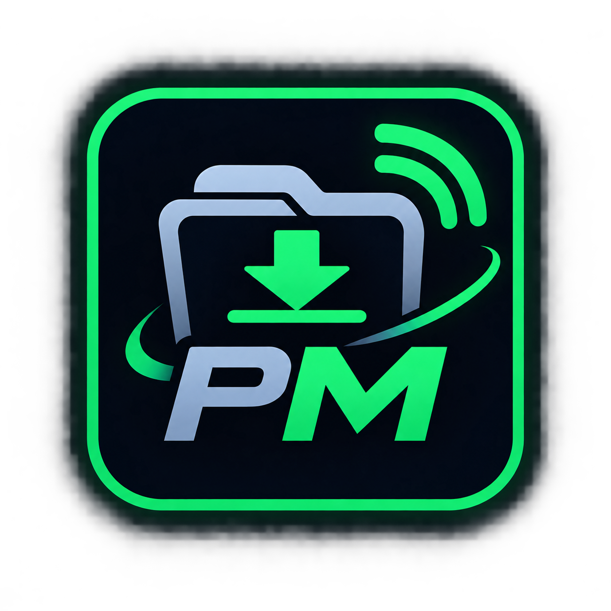

# ⚡ PureMUX v1.7

> **The ultimate local desktop media muxer and automotive encoder.** Built for uncompromised quality, zero-terminal friction, and seamless playback on home setups and JDM car headunits.



---

## 🚀 What is PureMUX?

PureMUX is a lightning-fast, self-contained Windows desktop application designed to pull, mux, and convert media streams with absolute precision. Abandoning clunky web apps and sketchy online downloaders, PureMUX runs entirely locally on your machine wrapped in a sleek, modern glassmorphism interface. 

Whether you're packing your local media library or prepping music videos and clips for your car’s navigation system, PureMUX handles the heavy lifting under the hood using **FastAPI**, **yt-dlp**, and **FFmpeg**.

---

## ✨ Key Features

* **🚗 Tailored JDM Automotive Profiles:** Built-in hardware-specific encoding presets for factory Japanese Domestic Market (JDM) headunits like the **Toyota NSZN-Z66T (10" display)** and **Carrozzeria Pioneer AVIC-MRZ02**, plus direct support for aftermarket **Android car screens**. No more stuttering or "unsupported codec" errors on your car display.
* **🔥 Lossless Quality Preservation (Standard Mode):** Bypasses unnecessary re-encoding by cleanly remuxing raw, highest-bitrate separate video (`bestvideo`) and audio (`bestaudio`) streams straight into pristine MP4s, alongside max-quality **320kbps MP3 audio extraction**.
* **💻 Zero Terminal Friction:** A native Windows application wrapper powered by `pywebview`—no command line, no python setup, and no browser sandbox download restrictions. Files drop directly into your Windows **Downloads** folder with a one-click **"Show in Folder"** integration.
* **🛡️ Modern Glassmorphic UI:** Clean, distraction-free dark mode interface featuring built-in terms compliance gates, live loading indicators, and multi-mode switching (Standard Media vs. Vehicle Headunit).

---

## 🛠️ Tech Stack & Architecture

* **Backend Core**: Python, FastAPI, Uvicorn, yt-dlp, FFmpeg
* **Desktop UI Wrapper:** pywebview (Native Windows WebView2 runtime)
* **Frontend Design:** Tailwind CSS with custom glassmorphism styling
* **Packaging:** PyInstaller (Standalone portable bundle & Inno Setup installer)

---

## 📋 Quick Start (For Developers)

If you want to run or build PureMUX from source:

1. **Clone the repository:**
   ```bash
   git clone [https://github.com/YOUR_USERNAME/PureMUX.git](https://github.com/YOUR_USERNAME/PureMUX.git)
   cd PureMUX